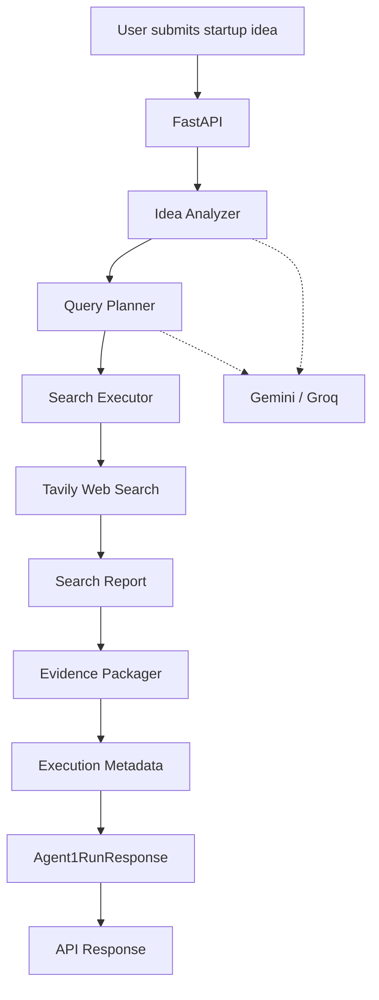

# AI-Based Startup Idea Validator
## System Architecture Documentation

### 1. Project Overview

The AI-Based Startup Idea Validator is a system designed to analyze startup ideas and support market research using Artificial Intelligence and web search.

The backend uses FastAPI to expose REST APIs. It integrates AI providers for startup idea analysis and research planning, and Tavily for retrieving relevant information from the web.

The system organizes collected information into a structured evidence package.

### 2. Technology Stack

| Technology | Purpose |
|---|---|
| Python | Backend programming |
| FastAPI | REST API development |
| Gemini | Primary LLM provider |
| Groq | Fallback LLM provider |
| Tavily | Web search |
| Pydantic | Data validation and schemas |
| Pytest | Automated testing |

### 3. System Architecture

The backend is organized into four major layers:

**1. API Layer**
- Implemented in `app/main.py`.
- Exposes REST API endpoints.
- Validates incoming requests.
- Handles exceptions and HTTP responses.

**2. Agent Layer**
- `idea_analyzer.py`: Understands and analyzes startup ideas.
- `query_planner.py`: Generates structured research queries.
- `search_executor.py`: Executes web searches.
- `evidence_packager.py`: Organizes and packages research evidence.
- `agent1_runner.py`: Coordinates the complete Agent 1 workflow.

**3. Provider Layer**
- `gemini.py`: Gemini integration.
- `groq.py`: Groq integration.
- `llm_router.py`: LLM provider routing and fallback.
- `tavily.py`: Tavily web search integration.

**4. Schema Layer**
- `idea.py`: Startup idea data models.
- `research.py`: Research planning data models.
- `evidence.py`: Evidence data models.
- `agent1.py`: Agent 1 response and execution metadata models.

### 4. Agent 1 Workflow

The complete workflow follows these steps:

1. The user submits a startup idea.
2. The Idea Analyzer processes the submitted idea and generates a structured idea brief.
3. The Query Planner creates research queries based on the analyzed idea.
4. The Search Executor sends the planned queries to Tavily.
5. Search results are normalized and collected.
6. The Evidence Packager organizes the collected sources and merges duplicates.
7. Execution metadata is generated.
8. The API returns the final Agent 1 response.

### 5. Architecture Flow Diagram

### 6. LLM Provider Fallback

The system integrates Gemini and Groq as language model providers.

- Gemini is used as the primary provider.
- Groq is available as a fallback provider.
- Provider execution metadata is maintained.
- Provider failures are handled through structured exceptions.
- Sensitive API credentials should not be exposed in API responses.

### 7. Error Handling

The backend handles different types of failures, including:

- AI provider configuration errors.
- AI request timeouts.
- Invalid AI responses.
- Web search failures.
- Partial search failures.
- Empty search results.
- Evidence packaging errors.

The Agent 1 workflow supports these overall statuses:

- `SUCCESS`
- `PARTIAL_SUCCESS`
- `NO_SOURCES`

When all planned searches fail, the system raises a structured search failure error.

### 8. API Layer

The FastAPI application exposes endpoints for:

- Startup idea submission.
- Startup idea analysis.
- Research planning.
- Evidence packaging.
- Complete Agent 1 execution.

The API uses structured request and response schemas and returns appropriate HTTP status codes for errors.

### 9. Testing Strategy

The backend uses Pytest for automated testing.

The test suite covers:

- Agent 1 pipeline execution.
- Idea understanding.
- Query planning.
- Search execution.
- Evidence packaging.
- LLM provider fallback.
- API integration.
- Error handling.

The current local test result during development was **68 passed and 7 skipped**.

### 10. Conclusion

The architecture separates API handling, agent orchestration, external providers, and data schemas.

This modular design supports maintainability, structured error handling, provider fallback, and independent testing of the startup idea validation workflow.
